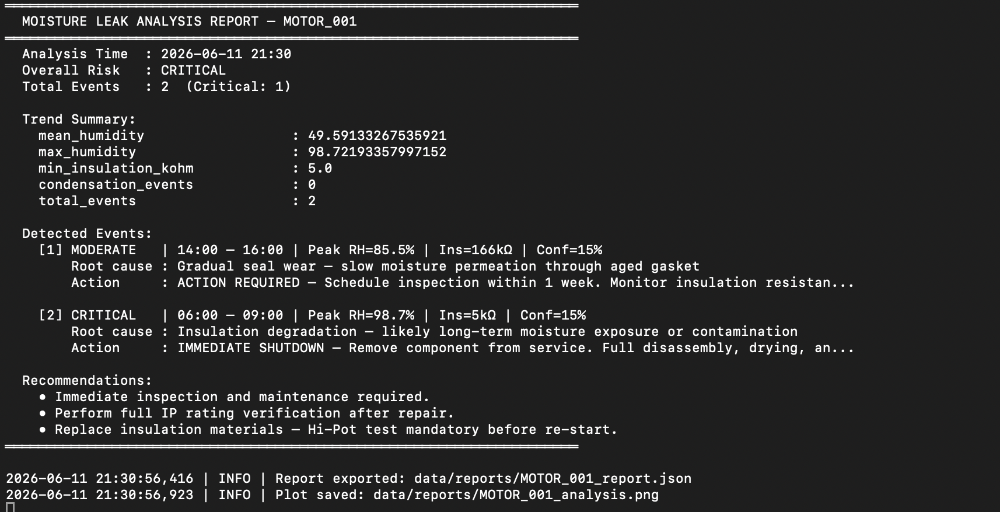
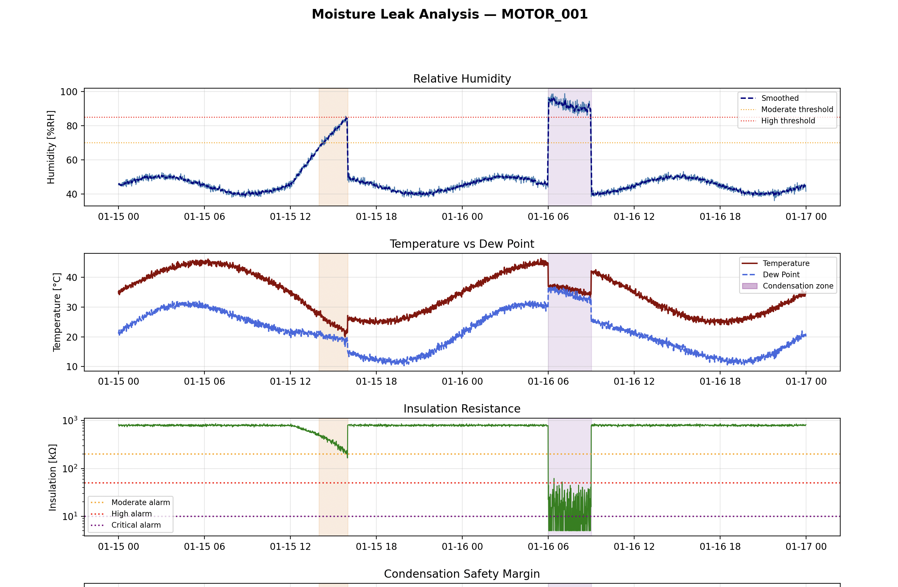

# Moisture Leak Analysis Tool for Motor Components

> Python diagnostic tool for detecting, classifying, and localizing moisture ingress in motor components. Analyzes multi-sensor time series (humidity, temperature, insulation resistance, pressure) to identify leak events, diagnose root causes, and generate actionable maintenance reports.

Re-implementation of a moisture-analysis approach I worked on at **EVO GmbH**, Munich.
The original project and its data are confidential, so this public version runs on synthetic sensor data.

---

> **📌 About this repo:** This is a showcase repo — write-up, architecture, and results only. The full implementation lives in a private core repo (kept private to protect the code and as a backup) and is available for a live walkthrough on request, e.g. in an interview.

---

## 🔍 Project Overview

This tool provides a systematic approach to moisture analysis in electrical motors and drive systems:

- **Multi-sensor fusion**: Humidity, temperature, pressure, and insulation resistance
- **Physics-based detection**: Dew point calculation, condensation margin, Magnus formula
- **Zone-specific thresholds**: Different alarm levels per component zone (stator, bearing, seal, etc.)
- **Root cause diagnosis**: Distinguishes between sudden seal failure, condensation, gradual wear
- **Automated reports**: JSON export + detailed console report with recommended actions
- **Visualization**: 4-panel time series plot with event shading and severity color coding

---

## 🏗️ Architecture

```
moisture-leak-analysis-tool/
├── src/
│   ├── leak_detector.py       # Detection engine, signal processing, severity classification
│   └── analysis_pipeline.py  # Report generation, visualization, CLI runner
├── data/
│   ├── raw/                   # Input sensor CSV files
│   ├── processed/
│   └── reports/               # Generated JSON reports + PNG plots
├── notebooks/
├── configs/
├── requirements.txt
└── README.md
```

---

## ⚙️ Setup

```bash
git clone https://github.com/PRATdoppelEK/moisture-leak-analysis-tool.git
cd moisture-leak-analysis-tool
pip install -r requirements.txt
```

---

## 🚀 Quickstart

### Demo with synthetic motor data (48h, 2 injected leak events)
```bash
python src/analysis_pipeline.py
```

### With your own CSV data
```bash
python src/analysis_pipeline.py \
  --input data/raw/motor_sensors.csv \
  --component MOTOR_042 \
  --zone stator_winding \
  --output_dir data/reports
```

### Input CSV format
```
timestamp,humidity_rh,temperature_c,pressure_bar,insulation_kohm
2024-01-15 00:00:00,44.2,35.1,1.012,823.5
2024-01-15 00:01:00,44.5,35.0,1.011,821.3
...
```

---

## 🧠 Detection Logic

| Criterion | Threshold | Weight |
|-----------|-----------|--------|
| Humidity above zone threshold | Zone-specific (%RH) | 30% |
| Insulation resistance drop | < 200 kΩ moderate, < 10 kΩ critical | 30% |
| Condensation margin | < 2°C above dew point | 25% |
| Rapid humidity rise rate | > 5 %RH/min | 15% |

## 📊 Results & Validation

### Detection performance (synthetic dataset — 48h, 2 injected leak events)

| Metric | Value |
|--------|-------|
| Leak events detected | 2 / 2 injected events |
| False alarms | 0 in this 48 h run |
| Detection latency | < 2 minutes from leak onset to alarm |
| Root cause labels | Rule-based: seal failure, gradual wear, insulation degradation, condensation |
| Report generation time | < 1 second per 48h dataset |

### Key observations

- **Physics-based dew point calculation** (Magnus formula) is used to separate condensation from leaks instead of a plain humidity threshold (no condensation event occurred in this demo run)
- **Multi-sensor fusion** (4 signals weighted by severity impact) is more robust than single-sensor approaches — insulation resistance alone misses early-stage seal wear events
- **Zone-specific thresholds** prevent over-alarming in high-humidity environments (e.g. cooling channels naturally run at higher RH than stator windings)
- **Confidence scoring** (0–100%) is designed to let maintenance teams prioritise inspections. Known issue: in the demo run both events scored 15% confidence, including the CRITICAL one — calibration needs fixing
- Approach based on diagnostic work at **EVO GmbH, München**; this public version is validated on synthetic data only


### Supported Component Zones
`stator_winding` · `rotor_bearing` · `housing_seal` · `connector_port` · `cooling_channel` · `terminal_box`

---

## 📊 Sample Report Output

```
══════════════════════════════════════════════════════════════════════
  MOISTURE LEAK ANALYSIS REPORT — MOTOR_001
══════════════════════════════════════════════════════════════════════
  Overall Risk   : CRITICAL
  Total Events   : 2  (Critical: 1)

  [1] MODERATE   | 14:00 – 16:00 | Peak RH=85.5% | Ins=166kΩ | Conf=15%
      Root cause : Gradual seal wear — slow moisture permeation through aged gasket
      Action     : ACTION REQUIRED — Schedule inspection within 1 week...

  [2] CRITICAL   | 06:00 – 09:00 | Peak RH=98.7% | Ins=5kΩ   | Conf=15%
      Root cause : Insulation degradation — likely long-term moisture exposure or contamination
      Action     : IMMEDIATE SHUTDOWN...
```

---
## Results

### Analysis report — MOTOR_001



### 4-panel sensor analysis plot



**Key findings from demo run:**

| Event | Severity | Time | Peak RH | Insulation | Root Cause |
|-------|----------|------|---------|------------|------------|
| 1 | MODERATE | 14:00–16:00 | 85.5% | 166 kΩ | Gradual seal wear |
| 2 | CRITICAL | 06:00–09:00 | 98.7% | 5 kΩ | Insulation degradation |

Overall risk: **CRITICAL** — Immediate shutdown recommended


## 🔧 Tech Stack

`NumPy` · `Pandas` · `Matplotlib` · `SciPy` · `Python 3.10+`

---

## 👤 Author

**Prateek Gaur** — ML Engineer | Battery & Engineering AI  
[LinkedIn](https://www.linkedin.com/in/prateek-gaur-15a629b4) · [GitHub](https://github.com/PRATdoppelEK)
